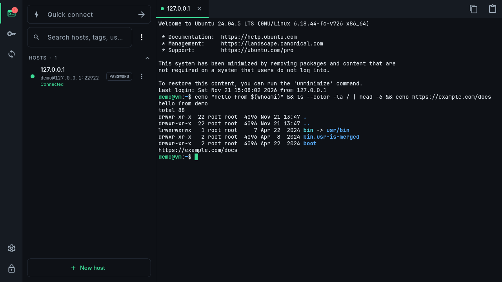

# SSH Sync

A personal SSH client for Android and Windows. Hosts, credentials and trusted
host keys are kept in step between your devices through a small server you
run yourself. The server only ever stores ciphertext, and everything keeps
working when it is unreachable.



## What is in this repository

| Path | What |
|---|---|
| `app/` | The Flutter application (Android, Windows; Linux builds too and is used for development) |
| `packages/core/` | Pure-Dart core: vault and encryption, local database, sync engine, SSH sessions, key and host import |
| `server/` | The sync server (FastAPI + SQLite, Docker). See [`server/README.md`](server/README.md) |
| `docs/PLAN.md` | Design: architecture, crypto, sync protocol, and the reasoning behind them |
| `docs/STATUS.md` | What is built, what was verified and how, and what is still open |
| `docs/MANUAL_TESTS.md` | Checklist to run on real devices |

## Getting the apps

Every push builds both apps in GitHub Actions (`.github/workflows/ci.yml`).
Open the latest run under the repository's **Actions** tab and download:

- `sshsync-android-apk` — sideload `app-release.apk`
- `sshsync-windows-installer` — `sshsync-setup-x.y.z.exe` (unsigned; Windows
  SmartScreen will ask once: "More info" → "Run anyway")
- `sshsync-windows-portable` — the same app as a folder, no install

### Android signing

Without a signing key the APK is signed with a debug key that differs per
build machine, so a later build will not install over an earlier one. For a
stable key, create one once:

```
keytool -genkey -v -keystore sshsync.jks -keyalg RSA -keysize 4096 -validity 10000 -alias sshsync
```

Put `sshsync.jks` in `app/android/` and create `app/android/key.properties`:

```
storeFile=sshsync.jks
storePassword=...
keyAlias=sshsync
keyPassword=...
```

Both files are git-ignored. Then `flutter build apk --release` in `app/`.

## Running the sync server

```
cd server
docker compose up -d --build
docker compose logs server     # shows the first one-time enrollment code
```

Put it behind TLS, or reach it only over your own tunnel. Details, backup
and recovery are in [`server/README.md`](server/README.md).

## First use

1. Install the app and create a vault with a master passphrase. **If you lose
   it, the data cannot be recovered.** Export an encrypted backup under
   Settings.
2. Add hosts by hand, with quick connect (`user@host:port`), or import an
   `ssh_config` file (Hosts → menu). On Windows you can import PuTTY sessions.
3. Optional: Sync → Connect to server, with the server address and the
   enrollment code from the server log.
4. Second device: on the first device open Sync → Add device. On the new
   device choose "I already have a vault on another device" and scan the QR
   (or type the three values), then enter your master passphrase.

## Security model in one paragraph

A random vault key encrypts everything (XChaCha20-Poly1305, libsodium). Your
passphrase protects that key through Argon2id (64 MiB, 3 passes). Whole
records, including hostnames and record types, are encrypted and padded
before upload. The copy of the passphrase-wrapped key that lives on the
server is sealed under a separate 256-bit *sync key* that never reaches the
server, so a stolen server database gives an attacker nothing to guess
against. Revoking a device stops it syncing; it cannot un-share what that
device already had, so rotate credentials if a device is lost.
`docs/PLAN.md` §5–6 has the details.

## Development

```
# core: unit tests, plus two real sync engines against the real server
cd packages/core && dart test -x ssh
sudo env "PATH=$PATH" dart test -t ssh     # real OpenSSH server; needs root

# server
cd server && uv run pytest

# app
cd app && flutter analyze && flutter test
flutter build linux --debug                # handy for looking at the UI
```

Flutter 3.50.1 / Dart 3.14. libsodium and SQLite are compiled by the
packages' build hooks, so a C toolchain is needed (Visual Studio Build Tools
on Windows, the NDK for Android).
